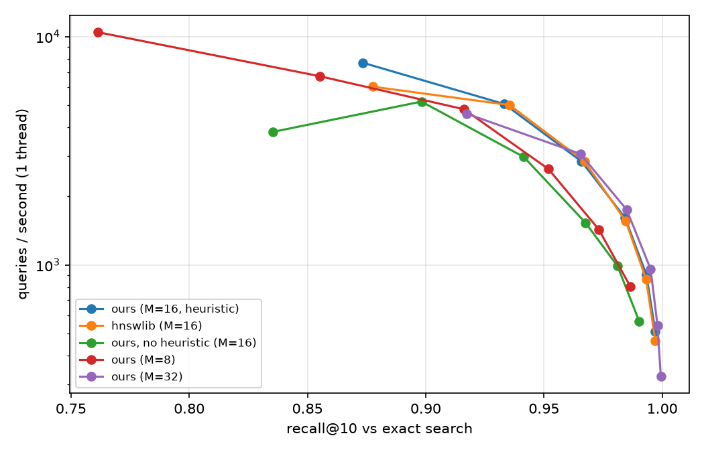

# Mini Vector Search Engine

A search engine for 50,000 MS MARCO passages, built to compare keyword search (BM25), dense
semantic search (MiniLM embeddings) and hybrid fusion, with a from-scratch **C++17 vector search
core** (exact top-k and HNSW) exposed to Python through pybind11, plus a Streamlit demo.

The goal was not just to build the pieces but to measure them honestly: every number below comes
from a script in this repo, hybrid weights are tuned on held-out queries, and negative results are
reported alongside the positive ones.

## Highlights

- **Dense search beat BM25** on this data: 0.893 vs 0.732 MRR@10 (all 1,000 queries).
- **Hybrid fusion did not help.** Equal-weight RRF lost 5 points to dense alone (0.844 vs 0.893).
  Weighted fusion, tuned on half the queries and scored on the other half, only tied dense (0.8972 vs 0.8967).
- **My HNSW matches hnswlib**: recall within 0.004 at every `ef`, throughput within noise, and about
  9x faster than my own exact search at 0.966 recall@10 (50K vectors, 1 thread).
- **The neighbour-selection heuristic is worth 1.6-1.9x throughput** at equal recall (0.95-0.99).
- **An AVX2 rewrite of the dot-product kernel gave 4.2x** on the exact-search path (MSVC build).
- 26 automated tests, including C++-vs-NumPy correctness checks.

## Demo

```
streamlit run app/demo.py
```

Runs one query through BM25, dense exact search, hybrid RRF and (optionally) the C++ HNSW index
side by side. Evaluation queries show a check mark on the human-labelled relevant passage, the hybrid
column shows each result's rank in BM25 and dense search, and a speed table times each step.
The HNSW index is built once (1-2 minutes) when you tick "Enable HNSW". Demo latencies vary between
runs and are not used for any claim below; the benchmark scripts are the source for speed numbers.

## Environment

Windows, MSVC 14.29 (Visual Studio 2019 Build Tools), Python 3.13.8, 11th Gen Intel Core i3-1115G4 @ 3.00 GHz
(4 logical processors). Embedding model: `sentence-transformers/all-MiniLM-L6-v2` (384 dimensions, 256-token limit).
All timings are single runs on one laptop unless stated; differences under about 10% are treated as noise.

## Data and evaluation protocol

- **Source:** MS MARCO passage ranking, dev-small queries and relevance labels.
- **Subset:** 1,000 sampled queries; all 1,069 passages labelled relevant for them are always included
  (1.07 per query on average); 48,931 random distractors; 50,000 passages in total. Median passage length
  is 50 words (95th percentile 102, maximum 230).
- **Why a subset:** embedding all 8.8M passages on a laptop takes days (the 50K subset took 54 minutes).
- **Reproducible:** fixed seed, sorted sampling, byte-identical output (tested).
- **Not comparable to the public leaderboard:** the corpus is about 176x smaller than full MS MARCO, so
  the task is much easier.
- **Metrics:** MRR@10, nDCG@10, Recall@10, Recall@100 against the human labels (binary relevance).
  ANN recall (does the index find the same top-10 as exact search?) is reported separately.
- **Held-out protocol:** the hybrid fusion weight is chosen on the first 500 queries and scored on the last 500.

## Results

### Retrieval quality (all 1,000 queries, 50,000 passages)

| System | MRR@10 | nDCG@10 | Recall@10 | Recall@100 |
|---|---|---|---|---|
| TF-IDF | 0.6912 | 0.7253 | 0.8540 | 0.9472 |
| BM25 (own implementation) | 0.7317 | 0.7596 | 0.8703 | 0.9492 |
| Dense exact (MiniLM) | **0.8931** | **0.9108** | **0.9753** | 0.9922 |
| Hybrid RRF, equal weights | 0.8442 | 0.8680 | 0.9572 | **0.9937** |
| HNSW (mine), ef=100 | 0.8875 | 0.9048 | 0.9683 | 0.9832 |
| HNSW (mine), ef=200 | 0.8910 | 0.9084 | 0.9723 | 0.9872 |
| HNSW (mine), ef=400 | 0.8930 | 0.9104 | 0.9743 | 0.9902 |

Replacing exact search with HNSW costs almost no search quality at `ef >= 200`.

### Hybrid fusion, tuned on held-out queries

Reciprocal Rank Fusion with a dense weight (BM25 weight = 1). MRR@10 on the **tuning half** (first 500 queries):

| Dense weight | 1 | 2 | 3 | 5 | 8 |
|---|---|---|---|---|---|
| MRR@10 | 0.8402 | 0.8625 | 0.8730 | 0.8796 | 0.8801 |

Scored on the **held-out half** (last 500 queries):

| System | MRR@10 | nDCG@10 | Recall@10 | Recall@100 |
|---|---|---|---|---|
| BM25 | 0.7408 | 0.7673 | 0.8730 | 0.9540 |
| TF-IDF | 0.7034 | 0.7352 | 0.8553 | 0.9510 |
| Dense exact | 0.8967 | 0.9121 | 0.9733 | 0.9890 |
| Hybrid RRF, equal weights | 0.8482 | 0.8706 | 0.9580 | 0.9920 |
| Hybrid RRF, dense weight 8 | 0.8972 | 0.9142 | 0.9783 | 0.9890 |

The best weight sat at the edge of the search grid and the gain over dense alone (+0.0005 MRR@10) is far
inside the noise for 500 queries. Conclusion: on this dataset BM25 adds no measurable value over dense search.

### Exact search speed (50,000 x 384, 1,000 queries, k=10, top-k agreement with NumPy = 1.0000)

| Backend | Time per 1,000 queries | QPS |
|---|---|---|
| NumPy (BLAS matrix multiply) | 1.55 s and 2.00 s (two runs) | 644 / 501 |
| C++, 1 thread, scalar dot product | 13.43 s | 74 |
| C++, 1 thread, AVX2 kernel | 3.17 s | 315 |
| C++, 2 threads, AVX2 | 1.80 s | 555 |
| C++, 4 threads, AVX2 | 1.16 s | 864 |

Single query (batch size 1): NumPy 7.05-7.60 ms, C++ 8.97 ms (1 thread), roughly a tie.
At 4 threads the C++ index is about 1.3-1.7x NumPy's batch throughput; on one thread it is slower.

### HNSW vs hnswlib (M=16, efConstruction=200, 1 thread, recall@10 against exact search)

| ef | Recall (mine) | Recall (hnswlib) | QPS (mine) | QPS (hnswlib) |
|---|---|---|---|---|
| 10 | 0.8734 | 0.8776 | 7,686 | 6,037 |
| 20 | 0.9333 | 0.9354 | 5,064 | 5,019 |
| 40 | 0.9659 | 0.9672 | 2,839 | 2,837 |
| 80 | 0.9843 | 0.9846 | 1,609 | 1,553 |
| 160 | 0.9933 | 0.9932 | 907 | 866 |
| 320 | 0.9971 | 0.9971 | 512 | 465 |

Build time: 78 s (mine) vs 66 s (hnswlib); one configuration of mine built in 78 s in one run and 136 s in another.
At `ef=40` my index reaches 0.966 recall@10 at 0.35 ms per query, versus 3.17 ms per query for my
exact C++ search on one thread (about 9x; about 3x against exact search on 4 threads).


### Ablations (QPS interpolated at fixed recall, 1 thread)

| Variant | QPS @ 0.95 | @ 0.98 | @ 0.99 | Build time |
|---|---|---|---|---|
| Mine (M=16, heuristic) | 3,765 | 1,837 | 1,119 | 78 s |
| hnswlib (M=16) | 3,863 | 1,822 | 1,076 | 66 s |
| Mine, no neighbour heuristic | 2,393 | 1,025 | 576 | 72 s |
| Mine, M=8 | 2,717 | 1,066 | not reached | 39 s |
| Mine, M=32 | 3,490 | 2,014 | 1,297 | 93 s |



- The neighbour-selection heuristic is worth 1.6x, 1.8x and 1.9x throughput at 0.95, 0.98 and 0.99 recall.
- `M=8` builds faster but is 28-42% slower at equal recall and never reached 0.99 within `ef <= 320`.
- `M=32` only pays off at high recall (10-16% faster at 0.98-0.99), with a roughly 19% slower build.

## What failed, and what I learned

- **Equal-weight hybrid fusion hurt.** Reciprocal Rank Fusion rewards passages that appear in both lists,
  so a passage that is mediocre in both can outscore one that is excellent in dense search and absent from
  BM25. With a much stronger dense retriever, that dilutes the result (0.844 vs 0.893 MRR@10).
- **My first C++ exact search was 8.6x slower than NumPy** (13.4 s vs 1.55 s, one thread). I suspected MSVC
  was not vectorising the float reduction and rewrote the dot product with AVX2 intrinsics (4.2x faster).
  The cause is inferred from the speedup; I did not inspect the generated assembly. With a different
  compiler the gain would differ: in a Linux/g++ test the intrinsics gave about 1.8x.
- **Threading scaled poorly from 2 to 4 threads** before the kernel fix, and 2.7x (not 4x) after it.
  Likely causes are hyperthreading (4 logical processors) and shared memory bandwidth; not isolated.
- **Single-query latency is no better than NumPy**, because a single query runs on one thread.
- **Query embedding dominates end-to-end latency** (160-260 ms in the demo) compared with any search step.

## Limitations

- One dataset (MS MARCO) at 50K vectors. Gaps between index variants usually grow with corpus size, and
  the hypothesis that hybrid retrieval helps on keyword-heavy text was not tested.
- Single runs without confidence intervals; timings moved by 30% or more between runs of the same code.
- MS MARCO labels are sparse (about one relevant passage per query), so unlabelled good answers count as
  misses and scores are conservative. Separately, the embedding model's training data may overlap with
  MS MARCO (check its model card), which could make dense scores optimistic.
- One embedding model, one machine, one operating system.
- HNSW construction is single-threaded, neighbour lists use nested vectors (poor cache locality), vectors are
  stored as float32 with no quantisation, and memory use was not measured.
- Next steps: bootstrap confidence intervals, a second domain (e.g. a BEIR dataset), a cross-encoder
  reranker over the top 100, a flat HNSW memory layout, and quantisation.

## Reproduce

```
python -m venv venv
.\venv\Scripts\Activate.ps1
pip install -r requirements.txt
# download the MS MARCO files into data/raw/ (see data/README.md)
python -m src.preprocessing.build_subset --num-queries 1000 --corpus-size 50000 --seed 42
python -m src.preprocessing.inspect_data
python -m src.embeddings.encode                       # about 1 hour on CPU
python setup.py build_ext --inplace --force           # needs MSVC build tools on Windows
python -m src.evaluation.evaluate --k 100 --with-hnsw
python -m benchmarks.bench_exact --k 10 --threads 1 2 4
python -m benchmarks.bench_ann --indexes ours hnswlib
python -m benchmarks.plot_ablation
python -m pytest
streamlit run app/demo.py
```

## Repository layout

```
app/demo.py                  Streamlit side-by-side demo
cpp/distance.hpp             AVX2 dot product (scalar fallback)
cpp/exact.hpp                exact top-k: heap, query tiling, OpenMP
cpp/hnsw.hpp                 HNSW with the neighbour-selection heuristic
cpp/bindings.cpp             pybind11 bindings
setup.py                     builds src/vecsearch_cpp
src/preprocessing/           subset builder and data inspection
src/retrieval/               BM25, TF-IDF, dense search, ANN wrappers, RRF fusion
src/embeddings/encode.py     MiniLM embeddings
src/evaluation/              metrics and the evaluation script
benchmarks/                  exact-search and ANN benchmarks, plots
tests/                       26 tests
docs/architecture.md         design notes
```

See `docs/architecture.md` for the design and `data/README.md` for data setup.