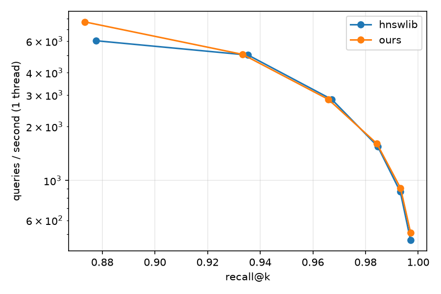

# Mini Vector Search Engine

Hybrid semantic search over a 50K-passage MS MARCO subset, built around a from-scratch C++17
vector search core (exact top-k and HNSW) with Python bindings (pybind11).

**Environment:** Windows, MSVC 14.29 (VS 2019 Build Tools), Python 3.13.8, 4 logical processors, [11th Gen Intel(R) Core(TM) i3-1115G4 @ 3.00GHz].
All timings are single runs on one laptop unless stated, so treat differences under ~10% as noise.

## What is in here

- BM25 (from scratch, sparse matrices), TF-IDF, dense retrieval (all-MiniLM-L6-v2), Reciprocal Rank Fusion
- C++ exact top-k search: size-k heap, query tiling, AVX2 intrinsics, OpenMP
- C++ HNSW index with the neighbour-selection heuristic, benchmarked against hnswlib
- Evaluation: MRR@10, nDCG@10, Recall@K, ANN recall vs exact search, 26 tests

## Retrieval quality (1,000 dev queries, 50,000-passage corpus)

| System | MRR@10 | nDCG@10 | Recall@10 | Recall@100 |
|---|---|---|---|---|
| TF-IDF | 0.6912 | 0.7253 | 0.8540 | 0.9472 |
| BM25 | 0.7317 | 0.7596 | 0.8703 | 0.9492 |
| Dense exact (MiniLM) | 0.8931 | 0.9108 | 0.9753 | 0.9922 |
| Hybrid RRF, equal weights | 0.8442 | 0.8680 | 0.9572 | 0.9937 |
| HNSW (ours), ef=100 | 0.8875 | 0.9048 | 0.9683 | 0.9832 |
| HNSW (ours), ef=400 | 0.8930 | 0.9104 | 0.9743 | 0.9902 |

Hybrid weighting was tuned on the first 500 queries and scored on the last 500: weighted hybrid 0.8972 MRR@10
vs 0.8967 for dense alone (a tie). Numbers are **not comparable** to the public MS MARCO leaderboard
(corpus is ~170x smaller, so the task is easier). MiniLM may have seen MS MARCO training data (check its
model card), so dense scores may be optimistic.

## Exact search speed (50K x 384-d, 1,000 queries, k=10)

| Backend | Time per 1,000 queries | QPS |
|---|---|---|
| NumPy (BLAS matrix multiply) | 1.55 - 2.00 s (varied between runs) | 501 - 644 |
| C++, 1 thread, before AVX2 kernel | 13.43 s | 74 |
| C++, 1 thread, AVX2 kernel | 3.17 s | 315 |
| C++, 2 threads | 1.80 s | 555 |
| C++, 4 threads | 1.16 s | 864 |

Single query (batch size 1): NumPy 7.60 ms, C++ (1 thread) 8.97 ms, roughly a tie.

## HNSW vs hnswlib and ablations (1 thread, recall@10 against exact search)




| Variant | QPS @0.95 recall | @0.98 | @0.99 | Build time |
|---|---|---|---|---|
| ours (M=16, heuristic) | 3765 | 1837 | 1119 | 78 s |
| hnswlib (M=16) | 3863 | 1822 | 1076 | 66 s |
| ours, no neighbour heuristic | 2393 | 1025 | 576 | 72 s |
| ours, M=8 | 2717 | 1066 | not reached | 39 s |
| ours, M=32 | 3490 | 2014 | 1297 | 93 s |

At ef=40 ours reaches 0.966 recall@10 at 0.35 ms/query, vs 3.17 ms/query for exact C++ search (1 thread).
QPS at a given recall is interpolated between the measured ef settings. Build time for one configuration
varied between 78 s and 136 s across runs, so quote it only roughly.

## Run it

```
python -m venv venv
.\venv\Scripts\Activate.ps1
pip install -r requirements.txt
# download MS MARCO files into data/raw/ (see data/README.md)
python -m src.preprocessing.build_subset --num-queries 1000 --corpus-size 50000 --seed 42
python -m src.embeddings.encode                       # ~1 hour on CPU
python setup.py build_ext --inplace --force           # needs MSVC build tools on Windows
python -m src.evaluation.evaluate --k 100 --with-hnsw
python -m benchmarks.bench_exact --k 10 --threads 1 2 4
python -m benchmarks.bench_ann --indexes ours hnswlib
python -m pytest
```

## What failed, and why

- **Equal-weight fusion hurt.** Hybrid RRF scored 0.844 MRR@10 vs 0.893 for dense alone. Weighting dense more
  heavily only recovered parity on held-out queries, so BM25 added nothing measurable here.
- **The first C++ exact search was 8.6x slower than NumPy** (13.4 s vs 1.55 s, one thread). A likely cause is that
  MSVC did not vectorise the float reduction loop. Rewriting the kernel with AVX2 intrinsics gave 4.2x (3.17 s),
  but one thread is still slower than NumPy's BLAS; it only wins with multiple threads.
- **Thread scaling was flat from 2 to 4 threads before the kernel fix** and close to linear after it.
- **Single-query latency is no better than NumPy**; per-query parallelism would need the corpus split across threads.

## Limitations

50K vectors only; single runs with no confidence intervals; one embedding model; index construction is
single-threaded; HNSW neighbour lists use nested vectors (poor cache locality, a flat layout is the next
optimisation); no quantisation. See `docs/architecture.md`.